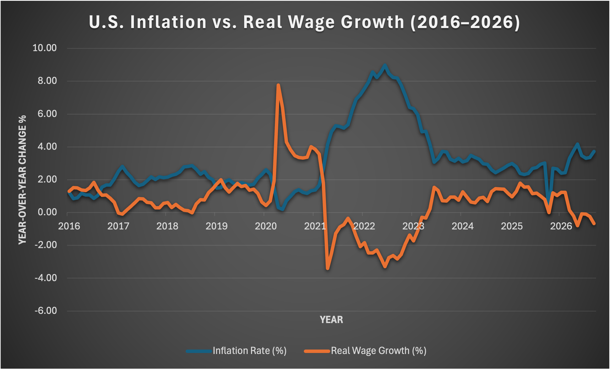
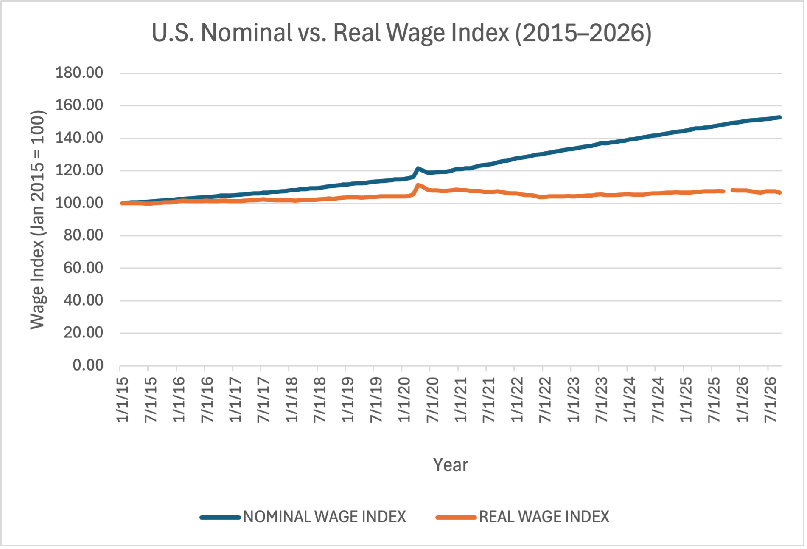

# U.S. Wage Growth & Inflation Analysis

## Project Overview
This project investigates whether wage growth in the United States has kept pace with inflation from 2015 onward.

## Business Question
Are American workers earning more in real terms, or has inflation reduced their purchasing power?

## Data Sources
- Federal Reserve Economic Data (FRED)
- Average Hourly Earnings (CES0500000003)
- Consumer Price Index (CPIAUCSL)

## Tools
- Microsoft Excel
- Python (pandas)
- SQL
- Power BI

## Project Objectives
1. Analyze changes in average hourly earnings.
2. Compare nominal wage growth with inflation.
3. Calculate inflation-adjusted wages.
4. Identify periods of increasing or decreasing purchasing power.
5. Build a dashboard to communicate the findings.

## Project Status
In progress — Week 1: Data collection and GitHub setup.

## Planned Deliverables
- Cleaned dataset
- Python analysis notebook
- SQL queries
- Power BI dashboard
- Summary of findings and limitations
## Data Visualizations

### 1. Inflation vs. Real Wage Growth

This chart compares the annual inflation rate with inflation-adjusted wage growth in the United States.

### 2. Nominal vs. Real Wage Index

Both wage indexes start at 100 in January 2015, allowing us to compare wage growth before and after adjusting for inflation.
